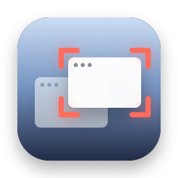
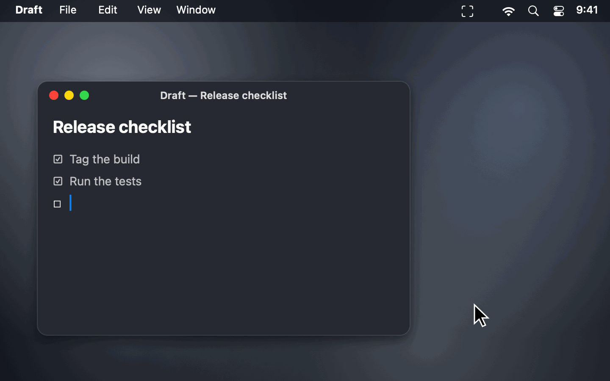
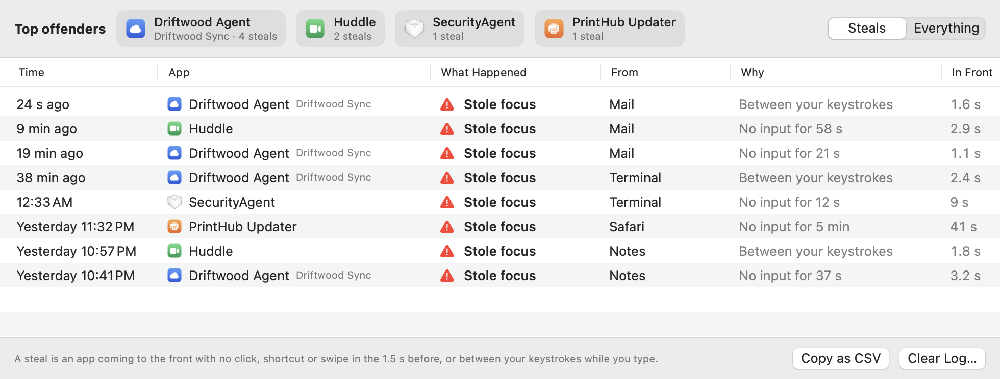

<p align="center">
  
</p>

<h1 align="center">Who Stole My Focus</h1>

<p align="center">
  <b>Find out which app keeps jumping in front of your work.</b><br>
  A free, open-source menu bar app that names every app that grabs focus on your Mac, and tells you when it happened while you were typing.
</p>

<p align="center">
  <a href="https://github.com/stanczykwyatt/who-stole-my-focus/releases/latest/download/Who-Stole-My-Focus.zip"><b>Download for Mac</b></a>
  &nbsp;·&nbsp;
  <a href="https://stanczykwyatt.github.io/who-stole-my-focus/">Website</a>
  &nbsp;·&nbsp;
  <a href="https://github.com/users/stanczykwyatt/projects/1">Roadmap</a>
  &nbsp;·&nbsp;
  <a href="https://github.com/stanczykwyatt/who-stole-my-focus/discussions">Discussions</a>
</p>

<p align="center">
  <a href="https://github.com/stanczykwyatt/who-stole-my-focus/actions/workflows/ci.yml"></a>
  <a href="https://github.com/stanczykwyatt/who-stole-my-focus/releases/latest"></a>
  
  
  
  
  <a href="LICENSE"></a>
</p>

<p align="center">
  
</p>

---

You're halfway through a sentence and the rest of it lands in some other window. A password prompt, an updater, a meeting app, a helper you've never heard of. By the time you look up, whatever did it is gone, and macOS doesn't keep a record.

Who Stole My Focus does. It sits in your menu bar and logs every app that comes to the front, then sorts out which ones you switched to and which ones jumped in on their own. When something steals focus, the icon changes, and the menu tells you exactly which app it was, what it took focus from, and whether you were typing at the time.

It needs no permissions at all, has no internet access, and is open source, so you can see exactly how it decides.

If it helps you catch something, [starring the repo](https://github.com/stanczykwyatt/who-stole-my-focus/stargazers) helps other people find it.

<picture>
  <source media="(prefers-color-scheme: dark)" srcset="docs/screenshot-dark.png">
  
</picture>

## Features

- **Names the culprit.** Every steal shows the app, what it took focus from, when, and how long it stayed in front. Helpers with cryptic names show the app they belong to, like *SyncHelper (CloudSync)*.
- **Catches steals while you type.** An app that jumps in between your keystrokes is flagged even though you were pressing keys a moment before. That's the case that sends your typing into the wrong window.
- **Doesn't blame you for your own switches.** Clicks, ⌘Tab, keyboard shortcuts, Spotlight and other launchers, swipes between Spaces, and apps you just opened are all recognized as yours.
- **Doesn't blame the app you were using.** When focus goes back to it after a password prompt, the lock screen or another app quitting, that's logged as coming back, not as a steal.
- **Explains system prompts.** *SecurityAgent* is macOS asking for your password, *coreautha* is Touch ID, *UserNotificationCenter* is a system alert. The log says so in plain words.
- **Top offenders.** See which apps steal focus most often, and which app they usually take it from.
- **The full story when you want it.** Switch the log to *Everything* to see every app that came to the front and why.
- **Optional notifications** the moment something steals focus, and **Copy as CSV** for a spreadsheet or a bug report to the app's developer.
- **Private by design.** No permissions to grant, no internet access, nothing ever leaves your Mac. Free, with no account, subscription, tracking or dependencies.

## How it decides

macOS tells every app when another app comes to the front, and how long ago you last clicked, typed or touched the trackpad. It doesn't say which key or where. From those two things, each switch gets one of these:

| What happened | When |
|---|---|
| **You switched** | A click, a keyboard shortcut like ⌘Tab, a key pressed in a launcher like Spotlight, or a trackpad swipe to another Space, just before. Parts of macOS you open yourself, like Mission Control, Notification Center and Spotlight, always count as you, even from a hot corner |
| **You opened it** | Its first trip to the front after you opened it, even if it took a while to start, or the app coming back after it quit to update itself |
| **Came back** | Focus returned to the app you were using after a system prompt, the lock screen, or the app in front quitting or hiding |
| **Stole focus** | None of the above: no click or keypress in the 1.5 seconds before, or you were typing before *and* after it came forward |
| **Not sure** | A plain keypress just before, and then you stopped typing: maybe you pressed Return on something that opens it, maybe not. Also anything before your first click or keypress after the app starts, like at login. Not counted as a steal |

A few details that keep it honest:

- **Typing through a switch counts as a steal.** If you pressed a key just before an app came forward and kept typing straight after, those keys were meant for the app you were in. It checks 0.4 seconds after the switch, quicker than you'd react to a new window, and a shortcut like ⌘T aimed at the new app doesn't count.
- **Every steal gets a second look.** macOS sometimes reports that the app in front quit or hid only after it has brought the next one forward, so a steal is only announced once that's ruled out.
- **Moving the pointer isn't a swipe.** macOS reports a trackpad gesture whenever you touch the trackpad, so a gesture only counts as a swipe if the Space actually changed.
- **The threshold is yours.** If links in your browser open slowly, or you want it stricter, change how soon after a click or keypress a switch still counts as yours, from 0.5 to 3 seconds.
- **It errs toward not blaming apps.** When it can't tell, it says so instead of calling it a steal. The lock screen and screen saver are ignored by default, and you can ignore any other app from its menu.

## Install

1. [Download **Who-Stole-My-Focus.zip**](https://github.com/stanczykwyatt/who-stole-my-focus/releases/latest/download/Who-Stole-My-Focus.zip) and unzip it.
2. Move **Who Stole My Focus** to your Applications folder and open it.
3. The log opens once so you can see what it does. After that it lives in your menu bar and opens at login. Turn that off from its menu.

> **About the security warning:** The first time you open Who Stole My Focus, macOS may say Apple couldn't verify that it's free of malware. It shows up because the app isn't notarized yet: Apple charges developers $99 a year for that, and this project hasn't paid the fee. The code is fully open source, so you can read every line or build the app yourself. To open it, go to **System Settings → Privacy & Security** and click **Open Anyway**.

> **Can't see the icon?** On a MacBook with a camera notch, menu bar icons that don't fit are hidden behind it. Hold ⌘ and drag the icon to the right, or quit a menu bar app you don't need.

### Build from source

You need macOS 14 or later and Swift 6, which comes with Xcode 16 or the Command Line Tools.

```bash
git clone https://github.com/stanczykwyatt/who-stole-my-focus.git
cd who-stole-my-focus
scripts/build-app.sh
open "build/Who Stole My Focus.app"
```

## How to use it

| To | Do this |
|---|---|
| See recent steals | Click the menu bar icon |
| See the details of one | Hover it in the menu: what it took focus from, why, how long it stayed, and when |
| See which apps steal most | Menu → Top Offenders, or the top of the log window |
| See every switch, not just steals | Menu → Open Log…, then choose Everything |
| Find the app on disk | Hover a steal → Show in Finder |
| Stop counting an app | Hover a steal → Ignore. Count it again from Ignored Apps |
| Get a notification for each steal | Menu → Notify Me About Steals |
| Make it stricter or looser | Menu → Counts as You Within |
| Report a misbehaving app to its developer | Right-click a row in the log → Copy Details, or Copy Steals as CSV. Your home folder shows as `~`, so your username isn't in it |
| Stop it opening at login | Menu → turn off Open at Login |

The icon changes to show an alert when something steals focus, and goes back to normal once you've looked.

## Privacy and security

Who Stole My Focus is built so it *can't* misuse your data, not just so it promises not to.

- **No permissions.** It doesn't ask for Accessibility, Input Monitoring, Screen Recording or anything else. Everything it uses, macOS offers to every app.
- **Never sees what you type.** It only knows *how long ago* you last pressed a key or clicked, never which key, what you typed or where you clicked.
- **Never sees your windows.** It records which app came to the front. Not window titles, not contents, not screenshots.
- **No internet access.** The app runs in the macOS App Sandbox without a network entitlement, so it can't send anything anywhere. CI checks every build for this.
- **No access to your files or other apps.** Its only entitlement is the sandbox itself: no file access, no Apple Events, nothing else.
- **Its log stays on your Mac,** in its sandbox container, capped at the last 5,000 switches. Clear it any time from the menu.
- **No dependencies.** Every line that runs is in this repository.

Check the app's permissions yourself with `codesign -d --entitlements - "/Applications/Who Stole My Focus.app"`. The full details are in [SECURITY.md](SECURITY.md).

## FAQ

**Why does my Mac keep switching windows by itself?**
Usually an app or background helper brings itself to the front: an updater, a sync client, a meeting app, a password or permission prompt. Who Stole My Focus logs every one, so the next time it happens you can see exactly which app it was.

**How do I find out which app is stealing focus on my Mac?**
Install Who Stole My Focus and leave it running. When an app takes focus without you switching to it, the menu bar icon changes and the menu names the app, what it took focus from and when.

**What is SecurityAgent, and why does it take focus?**
SecurityAgent is the part of macOS that asks for your password to approve a change, like an app installing a helper. It's usually another app that triggered it, and the log shows what was in front just before.

**Will it blame me for switching apps?**
No. Clicks, ⌘Tab, shortcuts, launchers like Spotlight, Raycast and Alfred, swipes between Spaces and apps you just opened all count as yours. When it can't tell, it says so instead of calling it a steal.

**Does it slow down my Mac?**
No. It doesn't run in a loop or poll anything. macOS tells it when an app comes to the front, and it does a few quick checks then and only then.

**Can it stop apps from stealing focus?**
Not yet. It's built to find the culprit so you can quit it, change its settings, or report it to its developer. Sending focus back automatically is on the [roadmap](https://github.com/users/stanczykwyatt/projects/1).

**Does it work on Intel Macs?**
Yes. The download runs on Apple silicon and Intel Macs with macOS 14 Sonoma or later.

## More free Mac utilities

- **[Show Desktop](https://github.com/stanczykwyatt/show-desktop):** hide every window with one click or ⌃⇧D, then bring them all back exactly as they were.
- **[Copy 2FA](https://github.com/stanczykwyatt/copy-2fa):** copy 2FA codes from Mail, Messages or a built-in authenticator with one keyboard shortcut.

All three have no internet access.

## Contributing

Contributions are welcome, especially reports of switches it judged wrong. See [CONTRIBUTING.md](CONTRIBUTING.md), and the [roadmap](https://github.com/users/stanczykwyatt/projects/1) for what's planned. Ideas go in [Discussions](https://github.com/stanczykwyatt/who-stole-my-focus/discussions).

## License

Who Stole My Focus is released under the [MIT License](LICENSE) and is provided as is, without warranty of any kind.

Who Stole My Focus is an independent project. It isn't affiliated with, endorsed by or sponsored by Apple Inc. Apple, Mac, macOS, Spotlight and Touch ID are trademarks of Apple Inc., registered in the U.S. and other countries. Other product names belong to their owners. The apps in the screenshots and demo that steal focus are made up.
